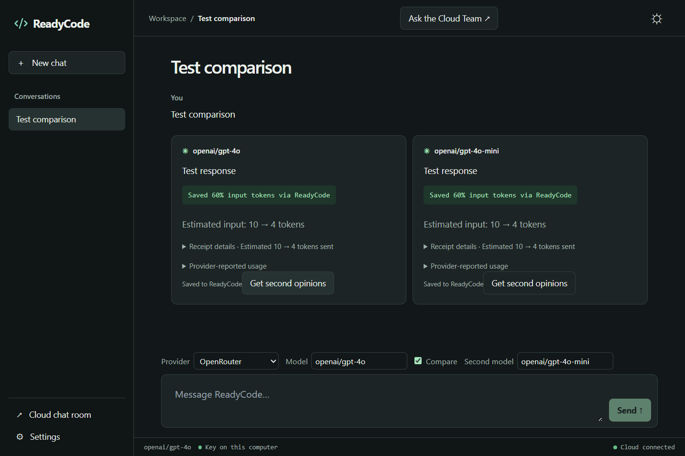

# ReadyCode Companion

ReadyCode Companion is a free, MIT-licensed desktop AI companion and multi-agent harness powered by ReadyCode Cloud.

**Windows x64 preview:** The unsigned 1.0.3 installer is available for testing. Read the release notes for the SHA-256 checksum and Windows installation steps. Install 1.0.3 manually over earlier previews. From 1.0.3, the Windows preview checks GitHub on launch and every four hours, downloads newer releases, and offers Restart to update. [Download the Windows preview](https://github.com/ReadycodeAI/readycode-companion/releases/tag/preview-windows-1.0.3)

The 1.0.2 preview includes Coding goals and setup instructions for Codex, Cursor and local model hosts. [Connect a local lead or IDE](docs/coding-goals.md).

- **Free AI harness.** Pair your ReadyCode account and bring a supported provider key, or start with a GroqCloud key on its free plan. Select **Ask the room** to get separate replies from your configured cloud agents in one chat. Attach a PDF, Word document or spreadsheet to ask about cited passages with ReadyCode Reader.
- **ReadyCode optimization.** ReadyCode keeps the full synced conversation in your account and reduces repeated context on its servers. Each new successful reply has its own savings receipt with estimated input tokens before and after compaction. Short chats can pass through whole.
- **Private and open.** The desktop client is MIT-licensed and includes no telemetry. Keys entered in the desktop app use OS secure storage. ReadyCode Agents uses the credentials you configure in your cloud account.

In ReadyCode’s synthetic 60-turn chat test, the final Gemini 3 Flash request used an estimated **1,411 input tokens instead of 10,614**, an 86.7% reduction for that request. [Savings examples](https://readycode.ai/savings) · [User guide](docs/user-guide.md) · [Web chat room](https://readycode.ai/account/chat-room)

**Cost and availability:** Companion access is currently free for enabled ReadyCode accounts. ReadyCode Cloud may charge for access in the future. AI provider usage is separate and follows your provider’s pricing and quotas. Asking two agents can incur two provider charges. The MIT license covers the desktop source code. ReadyCode runs the compaction and cloud agent services on its servers.

The MIT license lets you inspect, modify and redistribute the desktop client. The public project includes its user interface, local storage and the requests it makes to ReadyCode. ReadyCode operates the compaction service and cloud agents separately. See [what the desktop distribution contains](SECURITY.md#desktop-and-cloud).

## Connect a ReadyCode account

Visit the device pairing page, sign in and enter the eight-character code in Companion. Official builds connect only to the ReadyCode service configured at build time. For a development build with empty defaults, set the address and public key in Settings before pairing. Release builders supply `READYCODE_API_BASE` and a publishable (or legacy anon) `READYCODE_PUBLIC_KEY` at build time. Both are visible to recipients. [Device pairing](https://readycode.ai/account/device/pair)

After pairing, choose a provider in Settings and save its key. GroqCloud offers a free-plan starting point. The key is encrypted on this device and goes only to that provider. ReadyCode Agents uses cloud credentials from the website.

For every provider reply, the main process calls the authenticated `/compact` endpoint with the full turn context. It passes only the returned messages to the provider. An unreachable cloud service, invalid receipt, rejected device, or failed comparison compaction stops provider dispatch. Each completed answer shows the estimated input-token reduction and original and compacted counts beneath the text. Short passthrough turns show **Optimal context · 0% compaction needed**. Failed history uploads can be retried with their original receipt. Cached history remains on this device; unpaired history from older versions is never uploaded automatically.

## Providers and text files

To clean up your sidebar, click **×** beside a chat. **Remove from this device** removes the cached transcript and keeps any synced conversation in your web account. Companion remembers the removal for this pairing. **Delete here and on ReadyCode** asks ReadyCode to delete the synced conversation and removes the local copy only after the server confirms. If the server refuses or is unavailable, the local copy stays. Other computers can retain their own cached copies.

GroqCloud is the default starting option and has a free plan with limits. ReadyCode Agents runs on ReadyCode with the account’s cloud credentials. OpenRouter, OpenAI, Anthropic and Custom are optional independent connections, each with its own key. Use **Other providers…** to configure one. All user chat submissions go through ReadyCode.

Use **Attach files** for UTF-8 TXT, Markdown, CSV, TSV, JSON and log files. Before sending, you can remove individual files. Sending includes their names and entire text in the original user message and synced account history. The combined message is limited to 60,000 characters and eight files. Ordinary provider turns send only ReadyCode’s returned messages to the model; research submits the question and file text directly to ReadyCode’s research service. ReadyCode can keep the text whole, particularly on short chats. A savings receipt describes context reduction, not redaction, malware scanning or content moderation. PDF, DOCX and XLSX use the separate cloud Reader flow described below.

## ReadyCode Reader documents

Select PDF, DOCX or XLSX under **Attach files** and ask a question about the documents. Pressing Send uploads the originals to the paired ReadyCode Reader service. The desktop waits for cited evidence (page, section/paragraph, sheet/range), then submits only the question and excerpts through normal compaction or ReadyCode Agents. Chat history contains those excerpts. Reading, searching and exact spreadsheet calculations belong on ReadyCode. If Reader cannot verify evidence for any selected file, the whole turn stops before model dispatch. You can reattach a document for a different follow-up. Reader accepts up to eight attachments, 8 MiB of documents and a 16,000-character question per turn. Passage checking sends the question and candidate excerpts to OpenRouter using the key saved in the member’s ReadyCode account. Unchecked passages never start an agent call. Scans need server OCR support; legacy .doc/.xls and images are not accepted. Reader requires authenticated `/reader_context` and `/reader_result` on the paired service.

## Ask the Cloud Team

After a turn shows **Saved to ReadyCode**, choose **Ask the Cloud Team**. If the account has no cloud provider keys, the dialog offers the website’s AI setup page. Otherwise, it shows the room’s AIs or available providers. **Open on readycode.ai** takes you to the synced room. **Get second opinions** prepares a review prompt for the selected answer. It copies the prompt and opens the room. Paste and send it on the website. Cloud providers and agents run on readycode.ai under credentials configured there.

While a synced chat is open and focused, Companion reads messages every 15 seconds, pauses on blur and backs off after rate limits. Imported answers show the speaker and **via readycode.ai**. Switching chats or closing the app stops that room’s polling.

## Chat and web research from the composer

Choose **ReadyCode Agents → Ask the room**, select the agents you want, and use **Send to N agents**. One agent is selected initially. Each selected agent may incur provider charges. Companion submits one round to ReadyCode; the cloud saves one user message and each successful reply with its own savings receipt. You can retry an individual failed reply. The companion service must support `room_run`, `room_retry` and room updates on `messages`.

In a paired chat, choose **ReadyCode Agents** beside GroqCloud in the provider menu, pick an available cloud agent, and press **Send**. The server decides whether the request needs web research. Conversational replies can have an empty sources list and still carry a savings receipt. This requires automatic routing on the ReadyCode backend. The cloud service must implement `research_agents`, `research_run`, and the research fields on `messages`. This also supports starting a fresh paired chat. The desktop sends your question to ReadyCode using the device token and leaves the provider and search credentials on the server. It shows the run status, then the agent’s answer and numbered sources as they arrive in the room. Click a source to open its website. Research dispatch uses the authenticated `/research_run` endpoint directly. Cloud replies display the server-issued `receipt` from `/messages` when available. If a reply predates receipt support or the backend omits the receipt, the UI reports that it is unavailable.

## Privacy

Provider keys entered in Companion and device tokens use Electron OS secure storage. When you select a direct provider, Companion calls it from your desktop after ReadyCode compacts the context. ReadyCode Agents and Ask the room run in the cloud with credentials configured in your ReadyCode account. ReadyCode receives conversation context for compaction and saves completed synced turns, receipts and available usage data. Local transcript caches are JSON files in the OS user profile. The desktop includes no telemetry or analytics. The renderer is sandboxed with isolated context and blocked network access.

## Development

Use Node.js 24 and npm. Run `npm ci`, then `npm start`. Run `npm test` for protocol tests and `npm run build && npm run test:desktop` for the Electron test with simulated services. On Windows or macOS, `npm run portable` builds a runnable local edition for the host architecture. The Windows package is unsigned. The macOS build is ad-hoc signed and needs testing on macOS before release.

On Windows x64, run `npm run installer` for a per-user test installer. Official installed copies check GitHub Releases and offer **Restart to update** when the new version is ready. See [Windows releases](docs/windows-releases.md) for signing, profile continuity, and publishing.

The project uses Electron, TypeScript, Vite, React and Tailwind. `src/main.ts` owns IPC and turn execution, `src/network.ts` handles provider streams and ReadyCode requests, and `src/cloud-team.tsx` handles team discovery UI and focused-room polling. See LICENSE and SECURITY.md.

